## Testes e Evidências 
 - GET /chamados
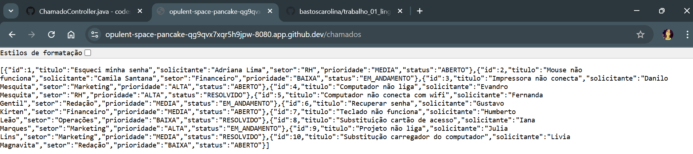
```
https://opulent-space-pancake-qg9qvx7xqr5h9jpw-8080.app.github.dev/chamados
```

```
[
  {
    "id": 1,
    "titulo": "Esqueci minha senha",
    "solicitante": "Adriana Lima",
    "setor": "RH",
    "prioridade": "MEDIA",
    "status": "ABERTO"
  },
  {
    "id": 2,
    "titulo": "Mouse não funciona",
    "solicitante": "Camila Santana",
    "setor": "Financeiro",
    "prioridade": "BAIXA",
    "status": "EM_ANDAMENTO"
  },
  {
    "id": 3,
    "titulo": "Impressora não conecta",
    "solicitante": "Danilo Mesquita",
    "setor": "Marketing",
    "prioridade": "ALTA",
    "status": "ABERTO"
  },
  {
    "id": 4,
    "titulo": "Computador não liga",
    "solicitante": "Evandro Mesquita",
    "setor": "RH",
    "prioridade": "ALTA",
    "status": "RESOLVIDO"
  },
  {
    "id": 5,
    "titulo": "Computador não conecta com wifi",
    "solicitante": "Fernanda Gentil",
    "setor": "Redação",
    "prioridade": "MEDIA",
    "status": "EM_ANDAMENTO"
  },
  {
    "id": 6,
    "titulo": "Recuperar senha",
    "solicitante": "Gustavo Kirten",
    "setor": "Financeiro",
    "prioridade": "MEDIA",
    "status": "ABERTO"
  },
  {
    "id": 7,
    "titulo": "Teclado não funciona",
    "solicitante": "Humberto Leão",
    "setor": "Operações",
    "prioridade": "BAIXA",
    "status": "RESOLVIDO"
  },
  {
    "id": 8,
    "titulo": "Substituição cartão de acesso",
    "solicitante": "Iana Marques",
    "setor": "Marketing",
    "prioridade": "ALTA",
    "status": "EM_ANDAMENTO"
  },
  {
    "id": 9,
    "titulo": "Projeto não liga",
    "solicitante": "Julia Lins",
    "setor": "Marketing",
    "prioridade": "MEDIA",
    "status": "RESOLVIDO"
  },
  {
    "id": 10,
    "titulo": "Substitução carregador do computador",
    "solicitante": "Livia Magnavita",
    "setor": "Redação",
    "prioridade": "BAIXA",
    "status": "ABERTO"
  }
]
```
 - GET /chamados/{id}
 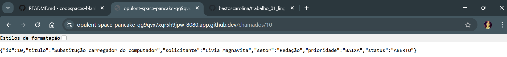
 ```
 https://opulent-space-pancake-qg9qvx7xqr5h9jpw-8080.app.github.dev/chamados/10
 ```
 ```
 {
  "id": 10,
  "titulo": "Substitução carregador do computador",
  "solicitante": "Livia Magnavita",
  "setor": "Redação",
  "prioridade": "BAIXA",
  "status": "ABERTO"
}
 ```
 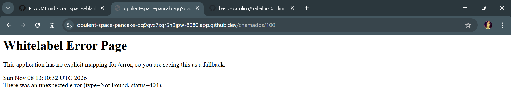
 ```
 https://opulent-space-pancake-qg9qvx7xqr5h9jpw-8080.app.github.dev/chamados/100
 ```
 ```
 Whitelabel Error Page
This application has no explicit mapping for /error, so you are seeing this as a fallback.

Sun Nov 08 15:21:50 UTC 2026
There was an unexpected error (type=Not Found, status=404).
 ```
 - GET /chamados/setor?nome=financeiro
 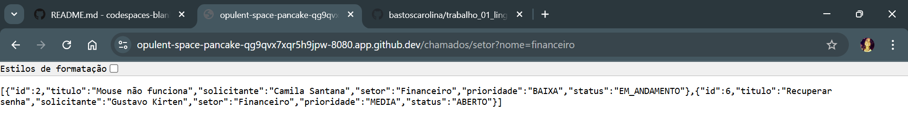
  ```
  https://opulent-space-pancake-qg9qvx7xqr5h9jpw-8080.app.github.dev/chamados/setor?nome=financeiro
 ```
 ```
 [
  {
    "id": 2,
    "titulo": "Mouse não funciona",
    "solicitante": "Camila Santana",
    "setor": "Financeiro",
    "prioridade": "BAIXA",
    "status": "EM_ANDAMENTO"
  },
  {
    "id": 6,
    "titulo": "Recuperar senha",
    "solicitante": "Gustavo Kirten",
    "setor": "Financeiro",
    "prioridade": "MEDIA",
    "status": "ABERTO"
  }
]
 ```
 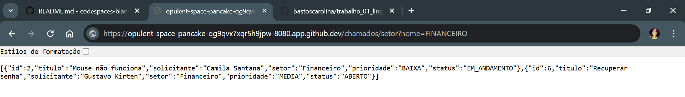
  ```
  https://opulent-space-pancake-qg9qvx7xqr5h9jpw-8080.app.github.dev/chamados/setor?nome=FINANCEIRO
 ```
 ```
 [
  {
    "id": 2,
    "titulo": "Mouse não funciona",
    "solicitante": "Camila Santana",
    "setor": "Financeiro",
    "prioridade": "BAIXA",
    "status": "EM_ANDAMENTO"
  },
  {
    "id": 6,
    "titulo": "Recuperar senha",
    "solicitante": "Gustavo Kirten",
    "setor": "Financeiro",
    "prioridade": "MEDIA",
    "status": "ABERTO"
  }
]
 ```
 - GET /chamados/prioridade?nivel=alta
 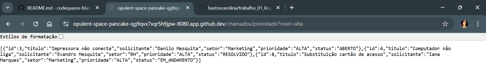
  ```
  https://opulent-space-pancake-qg9qvx7xqr5h9jpw-8080.app.github.dev/chamados/prioridade?nivel=alta
 ```
 ```
 [
  {
    "id": 3,
    "titulo": "Impressora não conecta",
    "solicitante": "Danilo Mesquita",
    "setor": "Marketing",
    "prioridade": "ALTA",
    "status": "ABERTO"
  },
  {
    "id": 4,
    "titulo": "Computador não liga",
    "solicitante": "Evandro Mesquita",
    "setor": "RH",
    "prioridade": "ALTA",
    "status": "RESOLVIDO"
  },
  {
    "id": 8,
    "titulo": "Substituição cartão de acesso",
    "solicitante": "Iana Marques",
    "setor": "Marketing",
    "prioridade": "ALTA",
    "status": "EM_ANDAMENTO"
  }
]
 ```
 - GET /chamados/busca?texto=impressora
 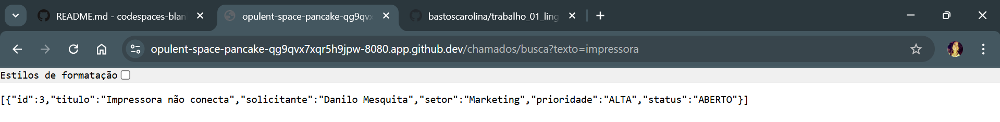
  ```
  https://opulent-space-pancake-qg9qvx7xqr5h9jpw-8080.app.github.dev/chamados/busca?texto=impressora
 ```
 ```
 [
  {
    "id": 3,
    "titulo": "Impressora não conecta",
    "solicitante": "Danilo Mesquita",
    "setor": "Marketing",
    "prioridade": "ALTA",
    "status": "ABERTO"
  }
]
 ```
 - GET /chamados/criticos
 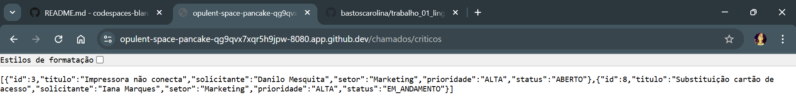
  ```
  https://opulent-space-pancake-qg9qvx7xqr5h9jpw-8080.app.github.dev/chamados/criticos
 ```
 ```
 [
  {
    "id": 3,
    "titulo": "Impressora não conecta",
    "solicitante": "Danilo Mesquita",
    "setor": "Marketing",
    "prioridade": "ALTA",
    "status": "ABERTO"
  },
  {
    "id": 8,
    "titulo": "Substituição cartão de acesso",
    "solicitante": "Iana Marques",
    "setor": "Marketing",
    "prioridade": "ALTA",
    "status": "EM_ANDAMENTO"
  }
]
 ```
 - GET /chamados/resumo
 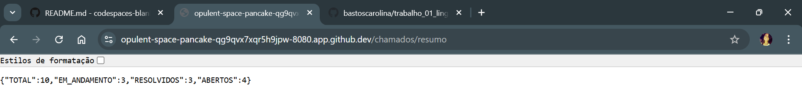
  ```
  https://opulent-space-pancake-qg9qvx7xqr5h9jpw-8080.app.github.dev/chamados/resumo
 ```
 ```
 {
  "TOTAL": 10,
  "EM_ANDAMENTO": 3,
  "RESOLVIDOS": 3,
  "ABERTOS": 4
}
 ```
 - POST /chamados
 ```
  curl -i -X POST localhost:8080/chamados   -H "Content-Type: application/json"   -d '{"titulo":"Monitor não liga","solicitante":"Marina Sena","setor":"RH","prioridade":"MEDIA"}'
 ```
 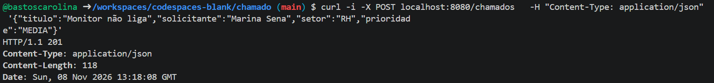
 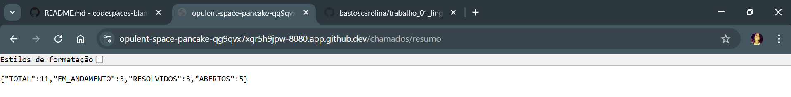
  ```
  https://opulent-space-pancake-qg9qvx7xqr5h9jpw-8080.app.github.dev/chamados/resumo
 ```
 ```
 {
  "TOTAL": 11,
  "EM_ANDAMENTO": 3,
  "RESOLVIDOS": 3,
  "ABERTOS": 5
}
 ```
 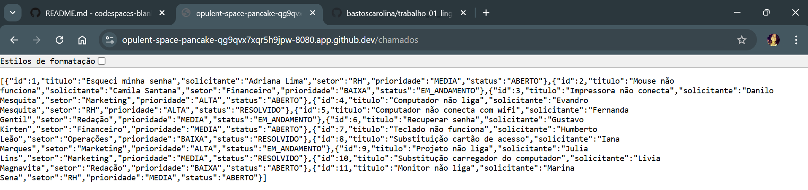
  ```
  https://opulent-space-pancake-qg9qvx7xqr5h9jpw-8080.app.github.dev/chamados
 ```
 ```
 [
  {
    "id": 1,
    "titulo": "Esqueci minha senha",
    "solicitante": "Adriana Lima",
    "setor": "RH",
    "prioridade": "MEDIA",
    "status": "ABERTO"
  },
  {
    "id": 2,
    "titulo": "Mouse não funciona",
    "solicitante": "Camila Santana",
    "setor": "Financeiro",
    "prioridade": "BAIXA",
    "status": "EM_ANDAMENTO"
  },
  {
    "id": 3,
    "titulo": "Impressora não conecta",
    "solicitante": "Danilo Mesquita",
    "setor": "Marketing",
    "prioridade": "ALTA",
    "status": "ABERTO"
  },
  {
    "id": 4,
    "titulo": "Computador não liga",
    "solicitante": "Evandro Mesquita",
    "setor": "RH",
    "prioridade": "ALTA",
    "status": "RESOLVIDO"
  },
  {
    "id": 5,
    "titulo": "Computador não conecta com wifi",
    "solicitante": "Fernanda Gentil",
    "setor": "Redação",
    "prioridade": "MEDIA",
    "status": "EM_ANDAMENTO"
  },
  {
    "id": 6,
    "titulo": "Recuperar senha",
    "solicitante": "Gustavo Kirten",
    "setor": "Financeiro",
    "prioridade": "MEDIA",
    "status": "ABERTO"
  },
  {
    "id": 7,
    "titulo": "Teclado não funciona",
    "solicitante": "Humberto Leão",
    "setor": "Operações",
    "prioridade": "BAIXA",
    "status": "RESOLVIDO"
  },
  {
    "id": 8,
    "titulo": "Substituição cartão de acesso",
    "solicitante": "Iana Marques",
    "setor": "Marketing",
    "prioridade": "ALTA",
    "status": "EM_ANDAMENTO"
  },
  {
    "id": 9,
    "titulo": "Projeto não liga",
    "solicitante": "Julia Lins",
    "setor": "Marketing",
    "prioridade": "MEDIA",
    "status": "RESOLVIDO"
  },
  {
    "id": 10,
    "titulo": "Substitução carregador do computador",
    "solicitante": "Livia Magnavita",
    "setor": "Redação",
    "prioridade": "BAIXA",
    "status": "ABERTO"
  },
  {
    "id": 11,
    "titulo": "Monitor não liga",
    "solicitante": "Marina Sena",
    "setor": "RH",
    "prioridade": "MEDIA",
    "status": "ABERTO"
  }
]
 ```


## Análise Técnica 
- Como o Spring Boot recebe e processa requisições HTTP.

 O Spring Boot recebe a requisição HTTP num servidor web embutido, que cria um HttpServletRequest e um HttpServletResponse. Em seguida, passa por alguns filtros servlet e segue para o DispatcherServlet, que é responsável por redirecionar a requisição para o controller correto. O controller executa a ação, retorna um objeto que será convertido para JSON e enviado de volta para o cliente.

- Qual é a função do Controller na aplicação.

A função do Controller é servir como camada de entrada que direciona a partir da requisição qual lógica deve ser executada e ao final retorna a resposta para o cliente. Ela fica entre o cliente e a lógica da aplicação.

- Como ocorre a conversão entre objetos Java e JSON.

A conversão entre objetos acontece através de um processo chamado des/serialização feito por uma biblioteca que, no caso de projetos usando o Spring Boot, já está inclusa. A serialização é o processo de objeto Java para JSON e a desserialização é o processo de JSON para objeto Java.

- Por que os chamados cadastrados não permanecem armazenados após reiniciar a aplicação.

Isso acontece pois os chamados não foram persistidos em um banco de dados, foram alocados na memória destinada à execução da aplicação e uma vez que a aplicação deixe de estar no ar essa alocação será desfeita.

